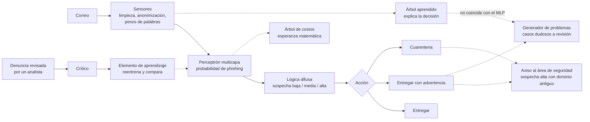
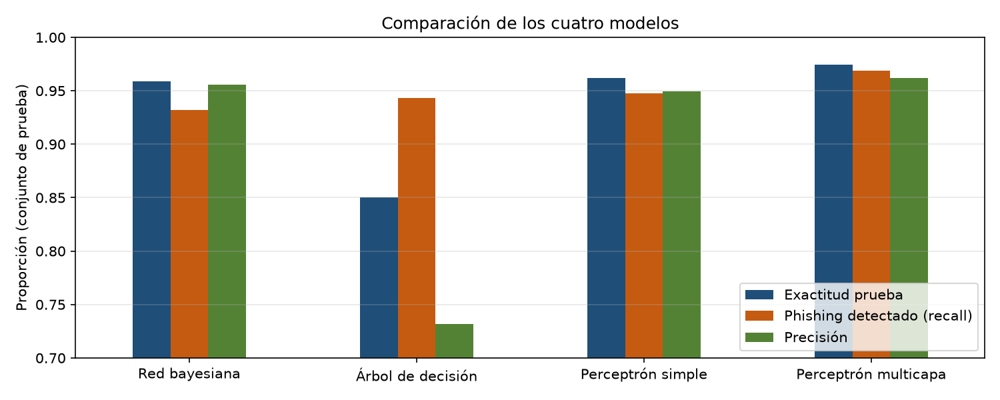
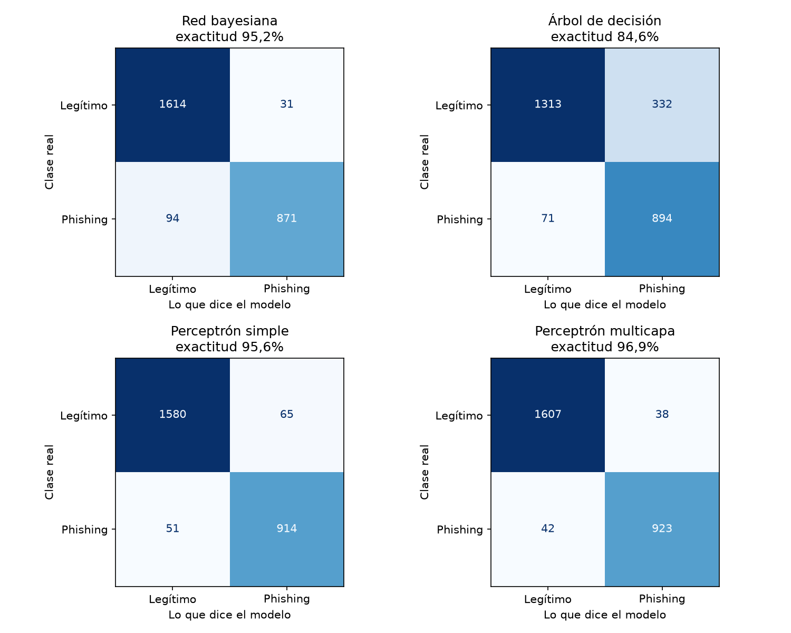
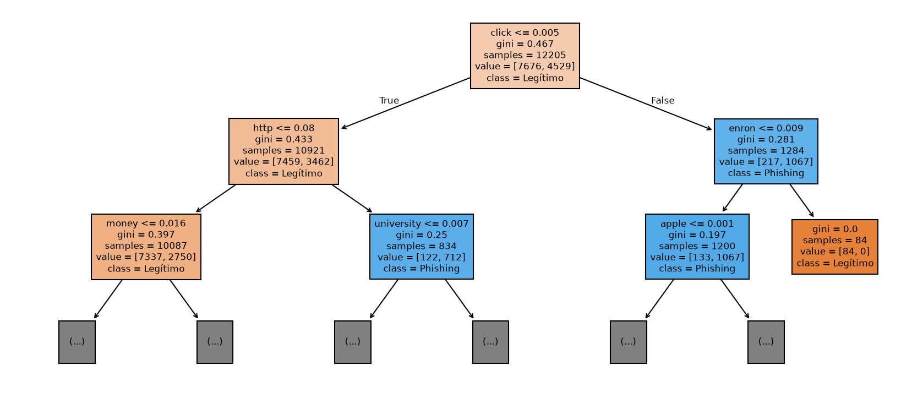

# Detección de phishing con IA — prototipo

Trabajo práctico final de **Inteligencia Artificial (0246)**, Universidad de Palermo, 2do cuatrimestre 2026.
Grupo 10: Alan Bazarian, Elias Joshua Caero, Ignacio Pacheco, Mateo Valenzuela y Valentino Albarian.

Este repositorio acompaña al documento del TP. Hace dos cosas:

1. **Compara cuatro modelos de la materia** sobre el mismo conjunto público de correos etiquetados (sección 5.4 del TP).
2. **Implementa el agente completo** que propone el TP: percibe un correo, estima la probabilidad de phishing, decide la acción con lógica difusa, la contrasta con el árbol de decisión de costos, explica por qué y aprende de las denuncias.

## El agente

Es el **agente que aprende** de la Figura 4 del TP, con sus cuatro componentes:



| Componente (apunte de Aprendizaje) | En el código |
|---|---|
| Elemento de rendimiento | `AgenteDetector.actuar()`: sensores → perceptrón multicapa → lógica difusa → una de las tres acciones de la Tabla 2 del TP, más el aviso a seguridad cuando corresponde |
| Crítico | `critico_registrar()`: guarda la denuncia revisada en `datos/denuncias.csv`, el estándar externo |
| Elemento de aprendizaje | `reentrenar()`: suma las denuncias, reentrena y **solo adopta la versión nueva si no empeora** sobre el mismo conjunto de **validación** (la prueba no se usa para decidir) |
| Generador de problemas | `generador_de_problemas()`: manda a `datos/a_revisar.csv` los correos que terminan con advertencia y aquellos en los que el árbol aprendido no coincide con el perceptrón multicapa |

Las acciones son las tres de la formulación del TP (entregar, entregar con advertencia, cuarentena). **Avisar al área de seguridad no es una cuarta acción**: es otro efector (Tabla 3 del TP) que acompaña a la cuarentena y a la regla «sospecha alta Y dominio antiguo».

## Probar un correo

```
python probar_correo.py ejemplos/01_banco_falso.txt --dominio-nuevo 0.9
```

```
1. Perceptrón multicapa -> probabilidad de phishing: 0,992
2. Sospecha (lógica difusa): baja 0,00 · media 0,00 · alta 1,00
   Dominio nuevo: 0,90 · dominio antiguo (complemento): 0,10
   Activación de cada regla (Y difuso = mínimo):
     SI sospecha alta Y dominio nuevo -> CUARENTENA + aviso                   0,90
     SI sospecha alta Y dominio antiguo -> ENTREGAR CON ADVERTENCIA + aviso   0,10
     SI sospecha media -> ENTREGAR CON ADVERTENCIA                            0,00
     SI sospecha baja -> ENTREGAR                                             0,00
   => ACCIÓN: CUARENTENA + AVISO AL ÁREA DE SEGURIDAD
3. Árbol de decisión de costos (esperanza matemática):
     ENTREGAR                        costo esperado 99,2
     ENTREGAR CON ADVERTENCIA        costo esperado 29,8
     CUARENTENA                      costo esperado 0,2
   => menor costo esperado: CUARENTENA
4. Por qué (camino en el árbol aprendido, que también dice «phishing»):
     aparecen:    «click»
     no aparecen: «enron», «apple», «exmh», «language», «executive», «september» ...
```

`--dominio-nuevo` es el grado de pertenencia (0 a 1) del dominio del remitente al conjunto difuso «dominio nuevo»; el dominio antiguo es su complemento (1 − μ). Si no se indica, vale 0,5. Con `--denunciar phishing` o `--denunciar legitimo` se registra la denuncia para el crítico, y `python agente.py` reentrena.

Los cinco correos de `ejemplos/` son inventados y están en inglés, como el conjunto de datos:

| Ejemplo | Probabilidad | Acción (difusa) | Árbol de costos | Árbol aprendido |
|---|---|---|---|---|
| `01_banco_falso` (dominio nuevo 0,9) | 0,992 | Cuarentena + aviso | Cuarentena | Coincide |
| `02_reunion` | 0,000 | Entregar | Entregar | Coincide |
| `03_premio` (dominio nuevo 0,9) | 0,998 | Cuarentena + aviso | Cuarentena | Coincide |
| `04_actualizar_datos` (dominio nuevo 0,1) | 0,830 | Entregar con advertencia + aviso | Cuarentena | Coincide |
| `05_aviso_de_sistemas` | 0,275 | Entregar | Entregar con advertencia | No coincide → a revisión |

- **Ejemplo 04:** la difusa tiene en cuenta que el dominio es antiguo (puede ser un proveedor real con la cuenta comprometida) y el árbol de costos no; por eso advierte y avisa en lugar de apartar el correo.
- **Ejemplo 05:** muestra por qué el TP usa el árbol de costos para **calibrar** la capa difusa (sección 4.2): con la Figura 7, la sospecha «baja» llega hasta 0,45, y para p = 0,275 la difusa entrega mientras que los costos de la Tabla 9 ya recomiendan advertir. Además, el árbol aprendido dice «phishing» y el perceptrón multicapa no: el agente no muestra una explicación que contradice su decisión y manda el caso a revisión.

## Resultados de los cuatro modelos (conjunto de prueba: 2.616 correos)

| Modelo | Exactitud | Phishing detectado | Legítimos marcados por error |
|---|---|---|---|
| Red bayesiana | 95,9 % | 93,2 % | 2,6 % |
| Árbol de decisión (12 niveles) | 85,1 % | 94,3 % | 20,4 % |
| Perceptrón simple | 96,2 % | 94,8 % | 3,0 % |
| Perceptrón multicapa (64 neuronas) | **97,4 %** | **96,9 %** | **2,3 %** |

Esos números usan el umbral 0,5. **Ajuste del umbral en validación:** `phishing_ia.py` elige, con el conjunto de validación, el umbral más bajo con el que no más del 1 % de los legítimos queda marcado por error. Da **0,77**, y medido una sola vez en prueba el perceptrón multicapa marca por error el **0,9 %** de los legítimos (cumple la meta de la sección 5.3) y detecta el **92,6 %** del phishing (queda debajo de la meta del 95 %). Para cumplir las dos metas a la vez faltan los rasgos estructurales.





Los primeros niveles del árbol aprendido muestran un **sesgo de los datos**: una de las primeras preguntas es la palabra «enron», porque muchos correos legítimos del conjunto vienen de esa empresa (Tabla 15 del TP).



## Relación con la materia

| Tema de la materia | Dónde está |
|---|---|
| Agentes: sensores, efectores, medida de rendimiento (Módulo 2) | `AgenteDetector.percibir()` y las cuatro acciones |
| Razonamiento probabilístico: red bayesiana, independencia condicional (Módulo 5) | Modelo «Red bayesiana» en `phishing_ia.py` |
| Aprendizaje supervisado e inductivo; agente que aprende (Módulo 6) | Todo el entrenamiento; `agente.py` |
| Árbol de decisión: nodos de decisión y de probabilidad, esperanza matemática (Módulo 6) | `arbol_de_costos()` |
| Árbol aprendido de ejemplos, que se lee como reglas (Módulo 6) | `AgenteDetector.explicar()` |
| Percepción: el sensor pasa un aspecto del entorno al programa agente (Módulo 7) | `AgenteDetector.percibir()` |
| Perceptrón y función sigmoidea (Módulo 8) | Modelos «Perceptrón simple» y «Perceptrón multicapa» |
| Perceptrón multicapa, backpropagation y descenso de gradiente (Módulo 9) | `MLPClassifier` con activación sigmoidea |
| Lógica difusa: pertenencia en [0, 1], complemento, Y = mínimo | `sospecha()` y `decidir_difuso()` |

**Fuera del material:** la biblioteca scikit-learn, que implementa los algoritmos, y el procedimiento interno con el que arma el árbol aprendido. No se desarrollan en el TP.

**Nombres de la biblioteca:** en el código aparecen `TfidfVectorizer`, que es la representación numérica de la sección 2.4 del TP (un peso por palabra que sube si se repite en el correo y baja si está en casi todos), y `MultinomialNB`, que es la red bayesiana de la sección 4.3 (un nodo «phishing» con una flecha a cada palabra, e independencia condicional).

## Datos

`datos/correos_anonimizados.csv`: 17.437 correos (10.966 legítimos y 6.471 de phishing) del *Phishing Email Dataset* (Kaggle; copia en https://huggingface.co/datasets/zefang-liu/phishing-email-dataset). Se quitaron los vacíos y los duplicados, y las direcciones de correo, los enlaces y los números largos se reemplazaron por `<EMAIL>`, `<URL>` y `<NUM>`.

División estratificada: 70 % entrenamiento, 15 % validación y 15 % prueba (semilla 42).

## Cómo ejecutarlo

```
pip install -r requirements.txt
python phishing_ia.py                                 # entrena, mide y guarda el modelo (~1 minuto)
python probar_correo.py ejemplos/02_reunion.txt       # prueba el agente
python agente.py                                      # reentrena con las denuncias registradas
```

El repositorio ya trae el modelo entrenado (`modelo/detector.joblib`), así que `probar_correo.py` funciona sin entrenar antes. `phishing_ia.py` reproduce exactamente los números de la tabla.

## Estructura

```
phishing_ia.py      entrena y compara los cuatro modelos; guarda el modelo del agente
agente.py           el agente que aprende (rendimiento, crítico, aprendizaje, generador de problemas)
probar_correo.py    prueba el agente con un correo y muestra el razonamiento
ejemplos/           cinco correos inventados
datos/              correos anonimizados
modelo/             modelo entrenado que usa el agente
resultados/         métricas y gráficos
```

## Limitaciones

- El conjunto de datos está en inglés: el agente no sirve todavía para correos en castellano (sección 2.3 del TP).
- Con el umbral elegido en validación se cumple la meta de menos del 1 % de falsos positivos, pero la detección baja al 92,6 %: todavía no se cumplen las dos metas a la vez (sección 5.3 del TP).
- Los rasgos estructurales de la Tabla 6 del TP (enlaces, dominios, SPF/DKIM/DMARC) no están implementados: el prototipo usa solo las palabras.
